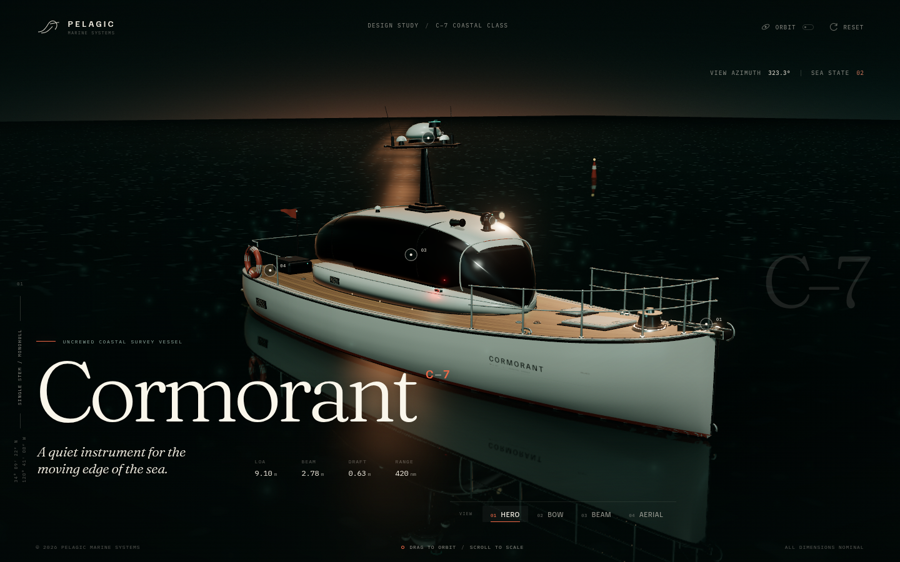
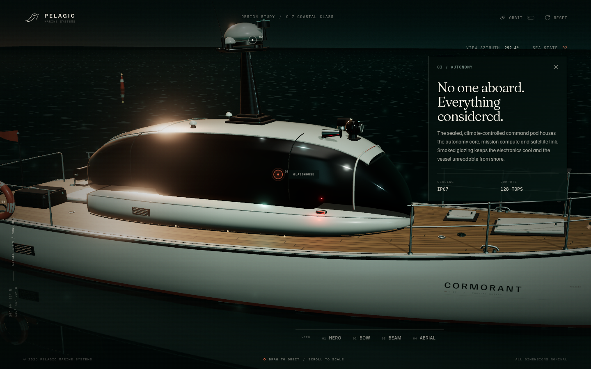
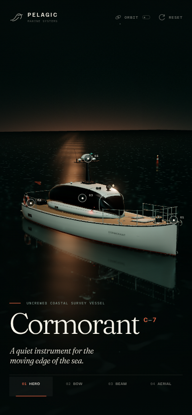
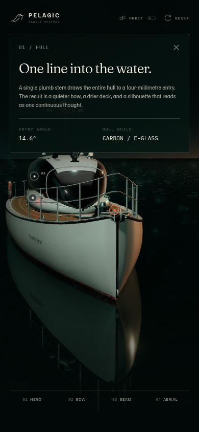

# Cormorant C–7 / 民用无人测量艇

一个完全基于 **Three.js** 构建的交互式民用无人艇概念设计。船体、材质、甲板木纹、玻璃、传感器桅杆与海面反射均程序化生成，没有外部 3D 模型或贴图。

**研究文档：** [《DeepSeek的建模水平大幅提升》中文 PDF](docs/deepseek-modeling-level.pdf) · [LaTeX 源码](docs/deepseek-modeling-level.tex)



## 海 / Cormorant C–7

9.10 m 单体无人测量艇。整艘船从一根连续的尖艏开始：没有双体、没有分叉，只有一条从水线延伸到甲板的单一艏柱。

- **船体**：PCHIP 非均匀站位 + 180 × 32 参数化放样；单一尖艏、深 V 艏部与完整艉板。
- **甲板**：程序化柚木纹理、连续舷缘盖板、黑色橡胶护舷、抛光不锈钢边线。
- **上层建筑**：烟色玻璃舱罩、白色硬顶、太阳能板、雷达/激光雷达/GPS/前视相机/探照灯。
- **甲板设备**：锚机与锚链、柚木舱口、系缆桩、栏杆、任务箱、回收绞盘、救生圈、旗杆、泳台与舷梯。
- **场景**：自定义平面反射海面、黄昏天空、星场、薄雾、PBR 材质与克制的泛光。

| 局部视角 | 移动端 | 移动端详情 |
| --- | --- | --- |
|  |  |  |

## 空 / SKYPRO XT

同一套程序化建模方法换到空中：相邻 Three.js 项目 **SKYPRO XT** 的四轴航拍无人机。硬边机身、镜像三叶桨、三轴云台与实体起落架，在摄影棚和夜航灯下共用一套结构。

| 夜航 | 正前 | 云台细节 |
| --- | --- | --- |
|  |  |  |

## 启动

要求 Node.js 20+。

```bash
npm install
npm run dev
```

生产构建：

```bash
npm run build
npm run preview
```

## 交互

- 拖拽环绕，滚轮 / 双指缩放。
- `HERO / BOW / BEAM / AERIAL` 四组视角，键盘 `1`–`4` 快速切换。
- 点击船体上的结构热点，打开详情并自动聚焦。
- 支持自动环绕、移动端响应式布局与 `prefers-reduced-motion`。

## 文档

- [研究文档 PDF](docs/deepseek-modeling-level.pdf)
- [LaTeX 源码](docs/deepseek-modeling-level.tex)
- 文档图版位于 `docs/figures/`；无人机截图来自相邻项目 SKYPRO XT，用于横向展示同一套程序化建模能力。

## 备注

这是一个虚构的民用船舶概念设计研究，不对应任何真实船厂或产品。所有尺寸为设计研究设定。
