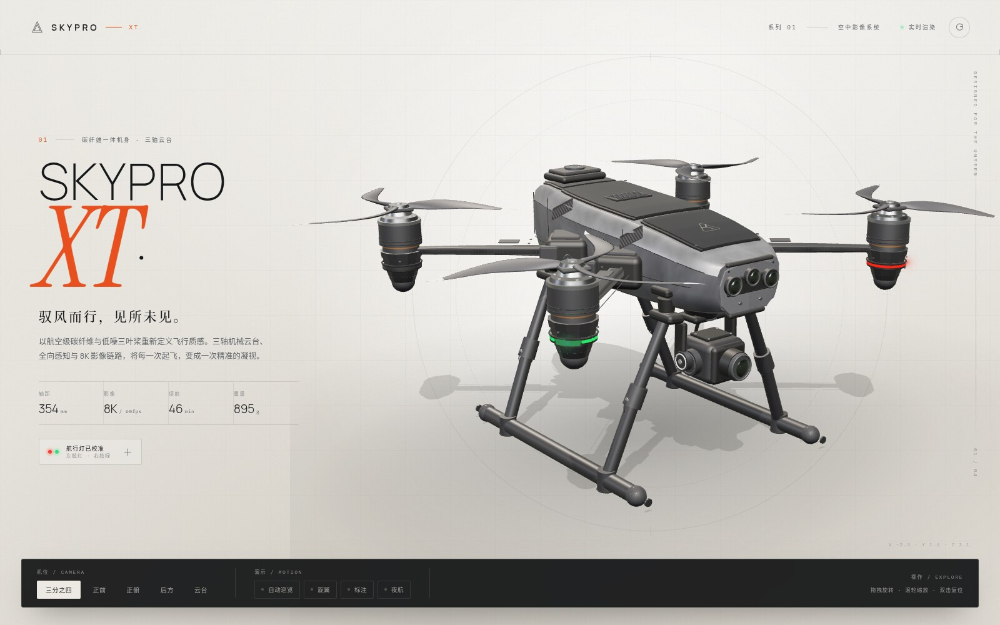
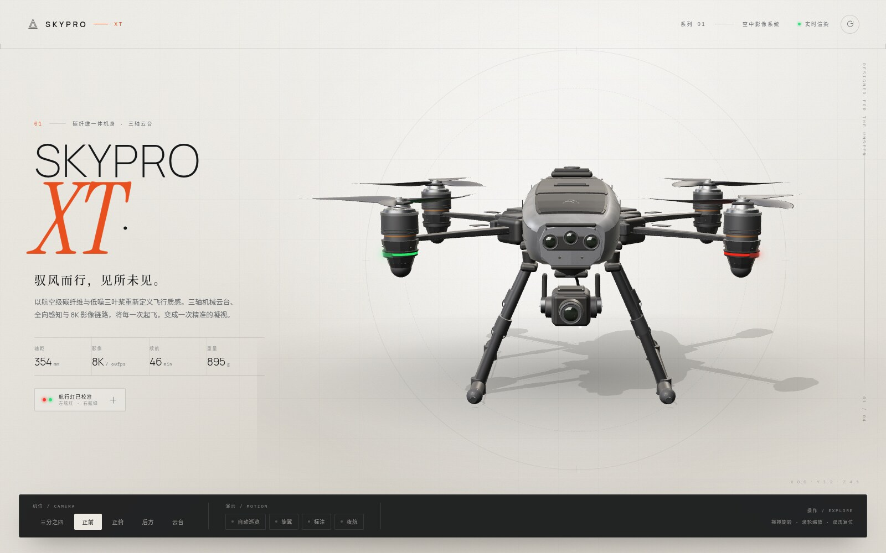
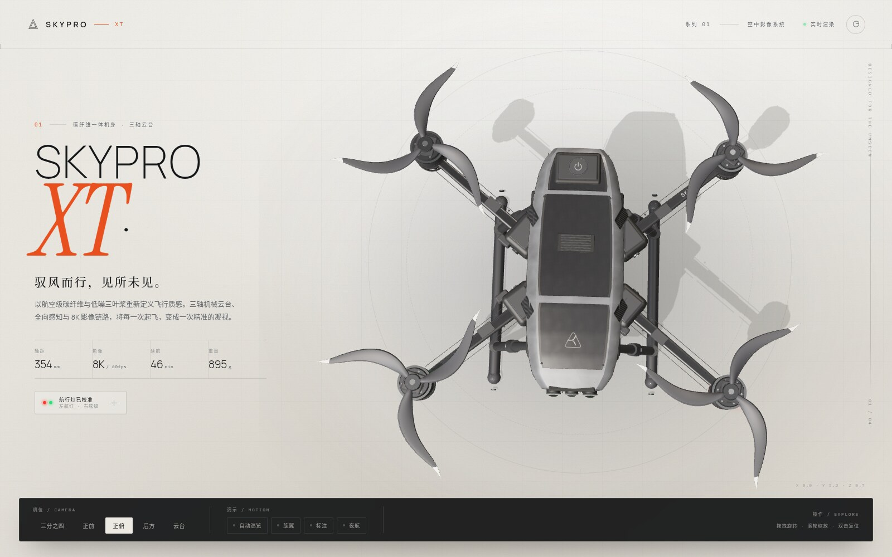
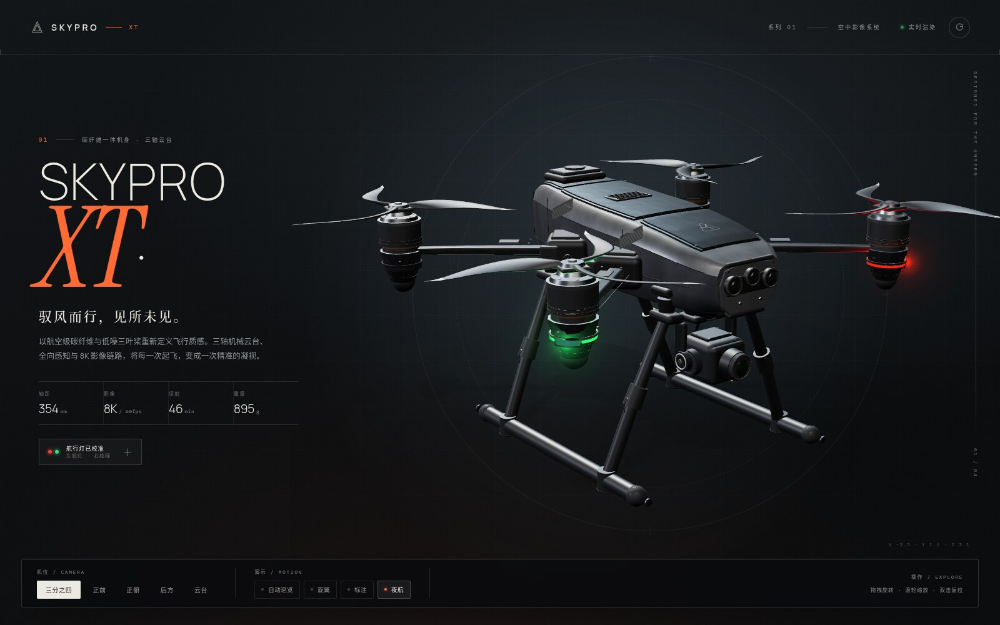
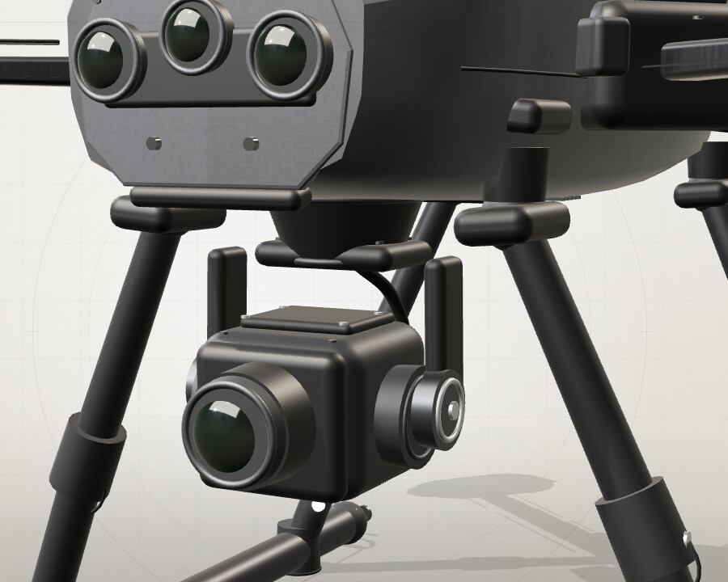

# SKYPRO XT · 实时三维无人机

基于 `figures/1.png`–`figures/4.png` 参考照片，用 **Three.js** 程序化重建的四轴航拍无人机交互展厅。
无需外部模型文件：机身、碳纤维纹理、桨叶、云台、起落架、贴纸与灯光均在浏览器中实时生成。



| 正前 · 三目感知 | 正俯 · 纵向滑撬 |
| --- | --- |
|  |  |

| 夜航 · 左红右绿 | 云台实体挂载 |
| --- | --- |
|  |  |

## 运行

```bash
npm install
npm run dev     # http://127.0.0.1:5173
```

生产构建：

```bash
npm run build
npm run preview # http://127.0.0.1:4173
```

建议使用支持 WebGL2 的桌面版 Chrome / Edge / Safari。三维画布按 2× DPR 渲染，移动端会自动调整取景距离。

## 交互

| 操作 | 说明 |
| --- | --- |
| 拖拽 | 环绕旋转视角 |
| 滚轮 / 双指 | 缩放 |
| 双击画布 | 复位到三分之四机位 |
| 视角按钮 | 三分之四 / 正前 / 正俯 / 后方 / 云台特写 |
| `1` – `5` | 快速切换机位 |
| `O` | 自动巡览开关 |
| `R` | 旋翼启停（高速时出现动态模糊盘） |
| `L` | 3D 部件标注开关 |
| `N` | 影棚 / 夜航模式 |
| `Esc` | 关闭航行灯说明面板 |

## 航行灯色位排查

参考图中的灯色确实存在矛盾：四张图并非同一套绝对朝向下的渲染结果，左右舷的绿 / 红色位在不同视角之间不能自洽。若直接照搬，会出现“同一侧在不同照片里既红又绿”的问题。

模型按**航空航行灯惯例**统一：

- **左舷（PORT，+X）→ 红色常亮**
- **右舷（STARBOARD，-X）→ 绿色常亮**
- 机头为 **+Z**、机背为 **+Y**，所以 **+X 为机身左侧**，−X 为右侧。因此在前视图中红灯位于画面右侧，绿灯位于画面左侧；俯视图（机头朝下）中红灯位于画面右侧，绿灯位于画面左侧。

UI 左下角的「航行灯已校准」按钮可打开灯位示意面板，右上角也有对应的红 / 绿图例。夜航模式下，灯窗外会额外生成柔和光晕，便于从各个角度核对。

## 模型细节

- **机身**：由多个独立硬边壳体拼合（顶甲板、肩部斜面、下壳、前后端盖），保留模具分模线与肩线；碳纤维顶盖、前甲板、后电池舱盖、格栅进气口、侧向斜百叶散热窗、电源按钮、螺钉。
- **动力系统**：X 形碳纤维支臂、折叠铰链罩、机臂丝印 `SKYPRO XT`、割草机式三叶桨（不同旋向的镜像桨型）、银色桨尖、四孔桨夹与中心螺栓、机加工铝制电机顶环、六角螺钉、铜色绕组细节。
- **云台相机**：三轴云台支架、双侧俯仰电机罩、球面镜片 + 绿色镀膜反射、状态灯、排线。云台通过**实体安装颈套 + 上下法兰**直接锁付在机腹硬点上，避免细偏航轴造成的视觉悬空；整组做了轻微尺寸收敛。
- **起落架**：**前后向双侧滑撬**（已按反馈将原横向支架旋转 90°），四条减震支撑腿、膝部套筒、脚端与前 / 后端盖；无横向底梁，俯视时与机体纵轴平行。
- **材质**：程序化碳纤维斜纹（颜色 / 凹凸 / 粗糙度三贴图）、石墨注塑面、拉丝铝、橡胶、黑玻璃、镀膜镜片、发光材质，全部使用 PBR + ACES 色调映射。
- **环境**：程序化生成的等距柱状摄影棚 HDR（顶部柔光箱 + 暖 / 冷侧光板 + 地面反弹），配合 PCF 阴影、柔和的接触阴影与 CSS 摄影棚背景。
- **交互与动效**：相机位插值、自动巡览、旋翼加速与动态模糊、LED 呼吸、云台微动、夜航模式过渡、响应式布局、加载与入场编排。

## 目录

```text
index.html
src/
  main.js                 # 场景、相机、灯光、交互、动画
  styles.css              # 展厅视觉与响应式布局
  drone/
    index.js              # 组装整机
    body.js               # 机身壳体、顶盖、传感器、进气口
    arms.js               # X 形支臂、电机、电调灯仓、桨组装配
    props.js              # 镜像三叶桨的几何生成
    gear.js               # 前后向双侧滑撬起落架
    gimbal.js             # 三轴云台相机
    textures.js           # 程序化贴图与贴纸
    materials.js          # PBR 材质库
    parts.js              # 放样 / 圆角 / 螺栓等几何工具
figures/                  # 原始参考照片
screenshots/              # 成品预览
```

## 说明

参考图属于 AI 生成的产品概念图，局部结构（尤其是左右灯色、机臂丝印位置、起落架形式）彼此矛盾。本作以照片中的整体比例、材质、碳纤维纹理、云台和桨型为还原目标，对相互冲突的细节按统一的机械与航电逻辑重建；起落架方向按本轮反馈采用前后向布局。

---

`SKYPRO XT` is a fictional product design reconstructed for demonstration purposes. Built with Three.js, Vite and a lot of procedural geometry.
